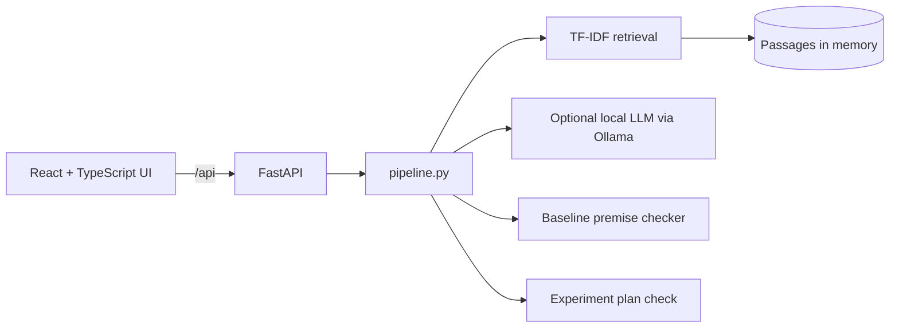

# HYPOGEN: Presentation Guide

> **Read the "Do not say" box first. It protects you in the Q&A.**

## 1. The one-sentence pitch

HYPOGEN helps a student turn a pile of papers into a **testable experiment idea**, and shows the **evidence for and against** every claim, with a paper and page citation, instead of just writing a confident-sounding answer.

## 2. Do not say (important)

| Do NOT say | Say this instead |
|---|---|
| "It achieves 88.3% accuracy" | "We have not measured accuracy yet. Evaluation is planned." (The 88.3%, 86.7%, 4.8 s and 300-hypothesis figures in the paper draft were never measured.) |
| "It discovers new hypotheses" | "It suggests experiments to test. The researcher decides." |
| "The AI verifies the claims" | "A keyword-based baseline checks for supporting and conflicting passages. The trained neural verifier is the next phase." |
| "No contradiction found, so the idea is novel / true" | "None found **in this small corpus**. That says nothing about the wider literature." |
| "It uses our own LLM" | "It can use a local pretrained model for drafting. Our own model is a small evidence verifier, not an LLM." |

## 3. What is real today vs planned

| Part | Status |
|---|---|
| Passage retrieval with scores | **Working** (TF-IDF) |
| Premise extraction with verified citations | **Working** |
| Support / conflict detection | **Working, as a keyword baseline** |
| Experiment completeness check | **Working** |
| Evidence highlighting, verdict, export, walkthrough | **Working** |
| Local LLM drafting | **Optional**, works if Ollama + qwen3:1.7b is running |
| PDF upload with page numbers | Planned |
| MiniLM embeddings + PostgreSQL/pgvector | Planned |
| Trained PyTorch two-channel verifier (~222k parameters) | **Planned, not built** |
| Comparison against a simple baseline, evaluation | Planned (Nov to Feb) |

## 4. Five-minute demo script

**Before you start:** backend and frontend running, browser at http://localhost:5173, one practice run done so you know what appears.

1. **(30 s) Problem.** "Students compare papers and want an experiment idea. Language models give confident answers with no proof. We make the evidence visible."
2. **(20 s) Library.** Point at the sidebar: "10 sample passages from 5 illustrative papers. These are written for the demo, not real quotes." Expand one paper.
3. **(60 s) Ask.** Click the first example question. While it loads: "It retrieves passages, drafts a prediction, then re-checks every premise."
4. **(60 s) Read the answer top to bottom.**
   - **Verdict banner:** "The most important finding comes first. Here, premises have conflicting evidence."
   - **Hypothesis:** point at the purple **UNTESTED PREDICTION** tag. "A guess is never shown as a fact."
   - **Premises:** open a red one. "Yellow words overlap with the premise. **Red words are cues of conflict**, like 'however' and 'did not'."
5. **(40 s) Experiment check.** Point at ✓ / ✗. Open **Edit experiment details**, clear "What result would disprove it?", ask again. "Now it is flagged as not testable."
6. **(30 s) How it was produced.** Open the timeline: "Six steps, real timings. Nothing hidden."
7. **(30 s) Export.** Click **Export report**. "The researcher can take this away."
8. **(30 s) Add a paper.** Paste two sentences in the sidebar, ask a related question, show the new passage appearing.
9. **(30 s) Honest close.** Open the walkthrough's last slide. "This is the baseline. Next: PDF upload, embeddings, and the trained verifier compared against a simple model."

If time is short, skip steps 6 and 8.

## 5. Likely questions and honest answers

**Is the verifier a trained model?**
Not yet. Today it is a keyword baseline. The plan is to train a small PyTorch network (about 222k parameters) from random weights that keeps supporting and conflicting evidence in separate channels, then compare it with a single-pool model. It may not win, and we will report that either way.

**Why is this not just ChatGPT?**
A chat model gives an answer. This keeps the answer tied to stored passages, searches for counter-evidence deliberately, checks citations by code, and flags missing experiment details.

**Is this new / novel?**
The idea is a candidate. Literature-grounded idea generation exists (for example SciMON), and combining positive and negative evidence has prior work. Novelty is **not established**. It must be shown by experiments.

**How accurate is it?**
Not measured. A small labelled test set (20 to 30 examples) is planned for the October smoke test and 100 to 200 reviewed examples for the final evaluation.

**Why a keyword checker if neural is the goal?**
It is the simplest baseline. The neural model has to beat it to justify itself.

**Does it use the internet or a paid API?**
No. Everything runs locally. An optional local model runs through Ollama.

**What are the limits?**
Tiny corpus, no PDF parsing yet, keyword cues miss subtle disagreement, similar words are not the same as support.

**Why FastAPI and React?**
FastAPI is Python, which matches the ML side, and it gives automatic API documentation at `/docs`. React with TypeScript gives a typed, maintainable interface.

## 6. Architecture

Planned: replace TF-IDF with MiniLM embeddings, memory with PostgreSQL + pgvector, and the baseline checker with the trained verifier.

## 7. Demo troubleshooting

| Symptom | Fix |
|---|---|
| Red banner "Cannot reach the backend" | Start `uvicorn main:app --port 8000` in the `backend` folder |
| Blank page | Run `npm install` then `npm run dev` in the `frontend` folder |
| Drafted by "template" | Normal if Ollama is not running. Say so. |
| Port already in use | Close the old terminal, or use `--port 8001` and change `vite.config.ts` |
